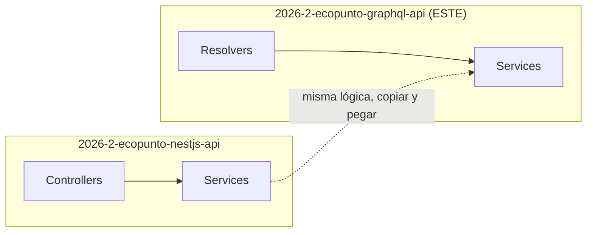

# Arquitectura — EcoPunto API (GraphQL)

> Taller GraphQL: **traducir el API REST de EcoPunto a GraphQL** manteniendo todas las funcionalidades.
> El dominio (entidades, reglas, dueños) es **el mismo** del repo `2026-2-ecopunto-nestjs-api`: lean su `ARCHITECTURE.md` para el modelo de datos, la máquina de estados y las reglas de negocio. Aquí solo va lo que cambia.

## 1. REST vs GraphQL en este proyecto



| Pieza | REST | GraphQL (este repo) |
|---|---|---|
| Entrada HTTP | `*.controller.ts` (`@Get`, `@Post`) | `*.resolver.ts` (`@Query`, `@Mutation`) |
| DTOs | `dto/*.dto.ts` (+ `@ApiProperty`) | `dto/*.inputs.ts` (`@InputType` + `@Field`) |
| Entidades | `@Entity` | `@Entity` **+ `@ObjectType`** (una sola clase) |
| Respuestas | JSON libre | Tipos del schema (`PaginatedPickups`, `RewardsSummary`...) |
| Docs | Swagger `/api/docs` | Schema autogenerado `src/schema.gql` + Apollo Sandbox |
| Auth | `AuthGuard('jwt')` | `GqlAuthGuard` (saca la `req` del contexto GraphQL) |
| Usuario actual | `@GetUser()` | `@CurrentUser()` |
| Errores | JSON de Nest | `formatGraphQLError` → `{ message, extensions: { code, statusCode } }` |
| Pruebas manuales | Postman REST | `operations/*.graphql` + Postman GraphQL (`pnpm postman`) |
| Puerto | 4000 | **4100** (pueden correr los dos a la vez) |
| BD Docker | 5433 | **5434** |

**Los services NO saben si los llama un controller o un resolver.** Cuando su service esté listo en el repo REST, lo copian aquí y solo cambian los tipos `*Dto` → `*Input`.

## 2. Estructura

```
src/
├── main.ts / setup-app.ts / app.module.ts   # GraphQLModule code-first (Apollo)
├── schema.gql                                # ⚙️ GENERADO al arrancar. Se commitea (sirve de documentación)
├── common/
│   ├── graphql/format-error.ts               # manejo uniforme de errores (10%)
│   ├── graphql/operations.spec.ts            # valida /operations contra el schema
│   ├── interfaces/paginated.interface.ts     # Paginated(Clase) -> tipo paginado genérico
│   └── dto/pagination.dto.ts                 # PaginationInput
├── auth/          👤 Santiago   # register, login, me, logout + GqlAuthGuard, @Auth, @CurrentUser
├── users/         👤 Santiago   # CRUD de usuarios (admin = "superadmin" del enunciado)
├── seed/          👤 Santiago   # mutation executeSeed
├── waste-categories/ collection-points/ addresses/   👤 Joshua
├── pickups/ rewards/ notifications/                  👤 María José
operations/                     # ⭐ queries/mutations de ejemplo + FRAGMENTS (10%)
postman/                        # colección GraphQL generada desde operations/
test/                           # e2e con supertest contra /graphql
```

## 3. Cómo encaja con el enunciado

| Enunciado | EcoPunto |
|---|---|
| Rol **superadmin** | `admin` |
| Rol **usuario regular** | `citizen` (además existe `operator`) |
| Superadmin crea/modifica/elimina usuarios | `createUser`, `updateUser`, `removeUser` (`@Auth(ValidRoles.admin)`) |
| Autenticados ven la lista de usuarios | `users` (`@Auth()`) |
| **Módulo 1** (entidad principal): CRUD de lo propio, admin de todo | **Pickups**: `createPickup`, `pickups`, `pickup`, `updatePickup`, `removePickup` |
| Vincular Módulo 1 con **Módulo 2** | Pickup → `items[].category` (WasteCategory), `address` (Address), `statusHistory` |
| JWT + proteger operaciones | `login`/`register` → token; todo lo demás `@Auth()` |
| Consultas y mutaciones (30%) | Todos los resolvers |
| **Fragments** (10%) | `operations/fragments.graphql` usados en todas las operaciones |
| **Manejo de errores** (10%) | `common/graphql/format-error.ts` + excepciones de Nest en los services |
| Validaciones | `class-validator` en todos los `@InputType` |
| Archivo para revisar funcionalidades | `postman/ecopunto-graphql.postman_collection.json` + `operations/` |

## 4. Reglas específicas de GraphQL

- **Code-first**: nunca editen `schema.gql` a mano; se regenera desde las clases.
- Cada campo expuesto lleva `@Field()`. Lo que NO tiene `@Field` (password, twoFactorSecret, tokenVersion) **no existe** en el API.
- Nullables explícitos: `@Field(() => String, { nullable: true })`. Números: `Int` o `Float`, nunca dejar que adivine.
- Enums: se registran con `registerEnumType` al final del archivo del enum.
- IDs como `ID` + `ParseUUIDPipe`: `@Args('id', { type: () => ID }, ParseUUIDPipe) id: string`.
- Mutations de borrado devuelven la entidad borrada (o desactivada), no `void`.
- Errores: lancen las excepciones de Nest de siempre (`NotFoundException('Recolección no encontrada')`). `formatGraphQLError` les pone el `code` (`NOT_FOUND`, `FORBIDDEN`, `BAD_USER_INPUT`, `UNAUTHENTICATED`...).
- Paginación: `PaginationInput` + `Paginated(Entidad)` → `{ data, meta { total page limit totalPages } }`.

### Fragments: el flujo de trabajo

1. Cada quien define los fragments de SUS tipos en `operations/fragments.graphql`.
2. Las operaciones de ejemplo de su módulo van en `operations/0X-*.graphql`, usando fragments (nunca repitan listas de campos).
3. `pnpm test` valida todas las operaciones contra el schema (si rompen un fragment, el CI falla).
4. `pnpm postman` regenera la colección de Postman a partir de esas operaciones.

## 5. Probar

- Apollo Sandbox: http://localhost:4100/graphql → pestaña *Headers*: `Authorization: Bearer <token>`.
- Postman: importar `postman/ecopunto-graphql.postman_collection.json` (Seed → Login → resto).

## 6. Git, tests, despliegue

Igual que el repo REST (ver su ARCHITECTURE §8 y §10): ramas `feat/...`, PR a `develop`, CI verde, commits pequeños de cada quien. El taller pide **despliegue en nube** y un **README con lo que no se alcanzó**.
